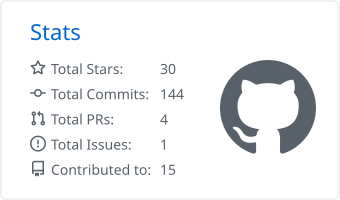
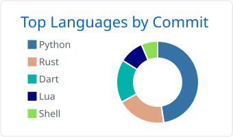

# Reza Hashemian

**Backend Engineer · Python & Django · M.Sc. in Artificial Intelligence**

I design backend systems that stay correct under load — clean service boundaries, 
money that always balances, and data models built for billions of rows.

 

 

## About

I am a backend engineer based in Isfahan, Iran. Django is my primary framework; around it I build
distributed systems with message queues, search engines and caching layers, and in my own time I
write desktop tools in Python, Rust and Dart.

- 🎓 M.Sc. in Artificial Intelligence — Islamic Azad University, Isfahan (Khorasgan); B.Sc. in Computer Networks
- 🏆 1st place, National Information Technology Olympiad
- 🎥 Teaching programming on [Learn Bytes](https://www.youtube.com/@learnbytes)

## Featured work

### Noqrina — commerce & ERP platform &nbsp;<code>private</code>

A multi-seller commerce platform that grew into a full business suite: online marketplace,
in-store point of sale, settlement, double-entry accounting, CRM, HR and manufacturing — one
codebase, run as independent services.

| | |
| --- | --- |
| **Architecture** | 15+ Django apps acting as microservices, each on its own PostgreSQL database; they talk only through RabbitMQ events with a transactional outbox and idempotent consumers |
| **Scale** | Partitioned ledgers and running-balance snapshots instead of summing history; a nightly health engine detects and repairs drift |
| **Finance** | Double-entry accounting with Jalali fiscal years, period locks, cost centers and year-end closing; seller settlement with held and released balances |
| **Delivery** | Typesense search, Varnish for public APIs, Redis for private ones, Celery workers, MinIO storage, Docker |
| **Quality** | 350k+ lines of Python covered by 6,500+ tests |

Django · DRF · PostgreSQL · RabbitMQ · Celery · Redis · Typesense · Varnish · Nginx · Docker

## Open source

| Project | Description | Stack |
| --- | --- | --- |
| [**tondar**](https://github.com/reza-hashemian/tondar) | Download manager with multi-connection resumable downloads, playlists, a scheduler and a browser extension | Python |
| [**amvault**](https://github.com/reza-hashemian/amvault) | Offline password and SSH key vault in KeePass format — desktop GUI, CLI and temporary ssh-agent loading | Python |
| [**eyecare-theme**](https://github.com/reza-hashemian/eyecare-theme) | Eye-comfort themes applied across terminals and editors at once, ranked by measured WCAG contrast | Python |
| [**dastbedast**](https://github.com/reza-hashemian/dastbedast) | Cross-device file transfer for Windows, Linux and Android — pair once, no server | Rust |
| [**nava**](https://github.com/reza-hashemian/nava) | A calm music and video player built on Slint and libmpv | Rust |
| [**varagh**](https://github.com/reza-hashemian/varagh) | PDF and EPUB reader with highlights, notes, notebooks and Trello-style tasks | Dart |
| [**shellter**](https://github.com/reza-hashemian/shellter) | One-script zsh setup that restores the same shell on any fresh machine | Shell |

## Toolbox

  
  
  
  
  
  

  
  
  
  
  

  
  
  
  
  
  

## Activity

<!-- Cards are generated daily into this repo by .github/workflows/profile-cards.yml -->

  <picture>
    <source media="(prefers-color-scheme: dark)" srcset="./profile-summary-card-output/github_dark/3-stats.svg" />
    
  </picture>
  <picture>
    <source media="(prefers-color-scheme: dark)" srcset="./profile-summary-card-output/github_dark/2-most-commit-language.svg" />
    
  </picture>

 

  Open to backend engineering roles and collaboration · Reach me on <a href="https://www.linkedin.com/in/rezahashemian">LinkedIn</a> or <a href="https://t.me/rezauplink">Telegram</a>

